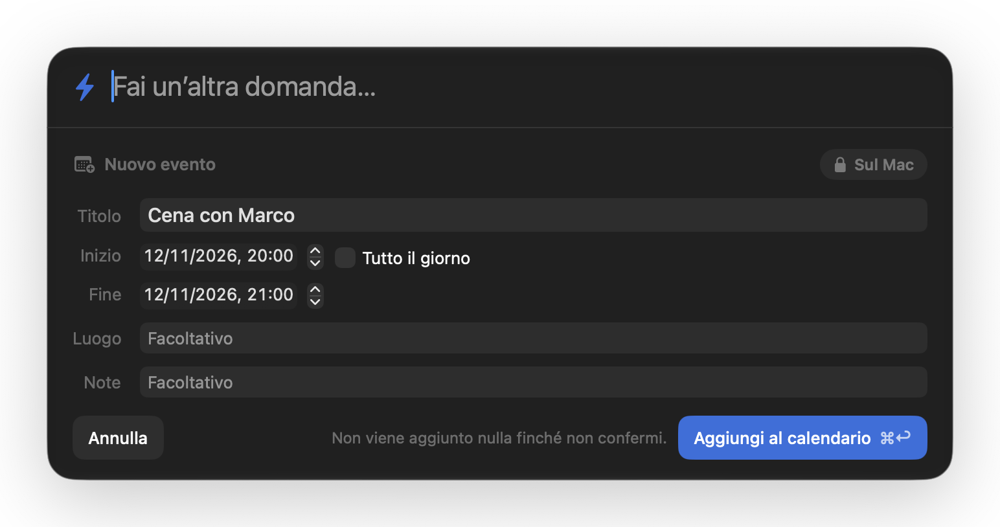

# Lampo

**L'intelligenza del tuo Mac, a una scorciatoia di distanza. Sul tuo testo, sul tuo schermo, nelle tue app.**

Lampo vive nella barra dei menu e porta il modello di Apple che gira sul tuo Mac dove serve:
sul testo che hai selezionato, sulla finestra che stai guardando, su quello che hai copiato.
Selezioni, premi un tasto, il testo cambia al suo posto.


> *In English:* Lampo is a menu bar app that brings Apple's on-device model to your context: the text
> you select in any app, the window in front of you, your clipboard. Fast, offline, free and private.
> The app is in English and Italian.

## Perché Lampo

1. **Velocissimo.** Si apre in un istante e risponde subito, senza attese di rete né caricamenti.
2. **Funziona offline.** In treno, in aereo, senza Wi-Fi: il modello è già sul tuo Mac.
3. **Gratis, per sempre.** Nessun abbonamento, nessun limite di richieste, nessuna chiave API, nessun account.
4. **Privato per davvero.** Quello che scrivi e selezioni non lascia il Mac. Il cloud privato di Apple
   si usa solo quando lo chiedi tu, e Lampo te lo dice sempre.
5. **Lavora dove sei.** Selezioni, premi un tasto, il testo cambia al suo posto. Nessun copia-incolla in una chat.
6. **Vede quello che vedi.** Chiedi spiegazioni su qualsiasi finestra: un errore, un grafico, un modulo.
7. **Su misura.** Crea azioni personali, ognuna con la sua scorciatoia e il suo prompt.
8. **Nativo e leggero.** Fatto per macOS, discreto nella barra dei menu, consumi minimi.

## Come si usa

### Vetro: chiedi da qualsiasi app

Premi **⌥⇧Spazio**: il pannello si apre sopra l'app che stai usando, senza toglierle il controllo.
Scrivi una domanda e la risposta arriva in streaming. Se hai selezionato del testo, Lampo lo aggiunge
come contesto. Poi puoi copiare (⌘C), inserire la risposta nell'app sotto (⌘↩), fare una domanda di
seguito o chiedere di approfondire. I calcoli ("12 * 3,5") li fa Lampo stesso, senza modello.

### Lente: riscrivi dove sei

Seleziona un testo in qualsiasi app e premi la scorciatoia di un'azione. La Lente mostra l'anteprima
accanto alla selezione; ↩ sostituisce il testo al suo posto e ⌘Z lo riporta com'era. Tab passa
all'azione successiva. Gli appunti restano quelli che avevi.

<!-- GIF da registrare: docs/media/lente.gif (vedi docs/media/README.md) -->

| Azione | Scorciatoia |
|---|---|
| Apri Lampo | ⌥⇧Spazio |
| Correggi | ⌥⇧C |
| Più formale | ⌥⇧F |
| Più breve | ⌥⇧B |
| Traduci in inglese | ⌥⇧T |
| Riassumi | ⌥⇧R |
| Chiedi allo schermo | ⌥⇧S |
| Crea evento | ⌥⇧E |
| Crea promemoria | ⌥⇧P |

Ogni scorciatoia si cambia in Impostazioni › Scorciatoie. In Impostazioni › Azioni puoi modificare le
azioni, crearne di nuove con il tuo prompt e provarle su un testo di esempio. Ogni azione può mostrare
l'anteprima, sostituire subito il testo, copiarlo o aprire la risposta nel pannello.

### Chiedi allo schermo

**⌥⇧S** fotografa solo la finestra che stai usando (mai Lampo stesso, mai il resto dello schermo) e
apre il pannello pronto per la domanda: "cosa significa questo errore?", "riassumi questa pagina".

<!-- GIF da registrare: docs/media/schermo.gif (vedi docs/media/README.md) -->

### Crea evento e Crea promemoria

Seleziona "cena con Marco giovedì alle 20" (o un'email con data e ora) e premi **⌥⇧E**: Lampo
prepara l'evento con giorno, ora, luogo e titolo. **Non aggiunge nulla finché non confermi**: tutto è
modificabile nella scheda. Per gli eventi Lampo chiede solo il permesso di scrittura, quindi non può
leggere i tuoi calendari. **⌥⇧P** fa lo stesso con i Promemoria.



### Comandi Rapidi e link

- In **Comandi Rapidi** trovi "Chiedi a Lampo" (restituisce la risposta) ed "Esegui azione Lampo"
  (esegue un'azione su un testo e restituisce il risultato).
- Il link **`lampo://ask?q=…`** apre il pannello e fa la domanda, per esempio da Raycast, Alfred o un
  segnalibro: `lampo://ask?q=Che%20ore%20sono%20a%20Tokyo%20se%20qui%20sono%20le%2015`.
  Un link non può eseguire azioni né modificare testo.

## Privacy

- Le richieste girano sul modello di Apple **sul tuo Mac**. Un badge dice sempre dove ha girato ogni risposta.
- **Private Cloud Compute** (il cloud privato di Apple) si usa solo quando premi "Pensa di più", nelle
  versioni che lo includono (richiede un'autorizzazione di Apple). Con **Solo sul Mac** attivo non si usa mai.
- Lampo va online solo per **controllare gli aggiornamenti** (Sparkle), e solo se lo consenti.
  Nessuna telemetria, nessun account, nessun dato di sistema inviato.
- La **cronologia** è spenta di default. Se la accendi resta solo sul Mac
  (`~/Library/Application Support/Lampo/history.json`) e spegnerla la cancella.
- Permessi: Accessibilità (leggere e sostituire la selezione), Registrazione schermo (solo per
  "Chiedi allo schermo"), Calendari e Promemoria (solo quando confermi un evento o un promemoria).

## Cosa non fa

- **Non è un motore di ricerca né un'enciclopedia.** Il modello sul Mac è piccolo: è bravo a
  riscrivere, riassumere, tradurre, estrarre e spiegare quello che ha davanti, non a ricordare fatti.
  Per date, nomi e numeri controlla sempre la fonte.
- Non naviga sul web e non legge i tuoi file, le tue email o i tuoi calendari.
- Non sostituisce un testo troppo lungo: se deve usarne un estratto, te lo dice e ti lascia solo copiare.

## Requisiti

- macOS 27 su Mac con Apple silicon
- Apple Intelligence attiva (Impostazioni di Sistema › Apple Intelligence e Siri)

## Installazione

Scarica l'ultima versione dalla pagina delle release, oppure con Homebrew (dal tap del progetto):

```bash
brew install --cask lampo
```

Al primo avvio una schermata di benvenuto spiega le tre scorciatoie e chiede il permesso di Accessibilità.

## Sviluppo

Serve Xcode 27 e [XcodeGen](https://github.com/yonaskolb/XcodeGen).

```bash
xcodegen generate
```

```bash
xcodebuild -project Lampo.xcodeproj -scheme Lampo -derivedDataPath build/DerivedData -clonedSourcePackagesDirPath build/SourcePackages test
```

Convenzioni, comandi e decisioni: [CLAUDE.md](CLAUDE.md) e [docs/DECISIONS.md](docs/DECISIONS.md).
Checklist manuale: [docs/MANUAL_QA.md](docs/MANUAL_QA.md).

### Pubblicare una versione

`scripts/release.sh` esegue i test, archivia con la firma Developer ID, notarizza, crea lo zip,
l'appcast di Sparkle e il cask Homebrew. Una tantum:

1. Un certificato "Developer ID Application" nel portachiavi.
2. Le credenziali del servizio di notarizzazione:
   `xcrun notarytool store-credentials lampo-notary --apple-id <id> --team-id 9K3LNS3KHP`
3. La chiave EdDSA di Sparkle (resta nel portachiavi; il comando stampa la chiave pubblica):
   `build/SourcePackages/artifacts/sparkle/Sparkle/bin/generate_keys`
4. `cp Packaging/release.env.example Packaging/release.env` e compila URL del feed, prefisso dei
   download e chiave pubblica.

Poi:

```bash
scripts/release.sh
```

Per una prova locale senza notarizzazione: `scripts/release.sh --skip-notarize --skip-appcast`.
La versione è `MARKETING_VERSION` in `project.yml`; il numero di build è il numero di commit.
